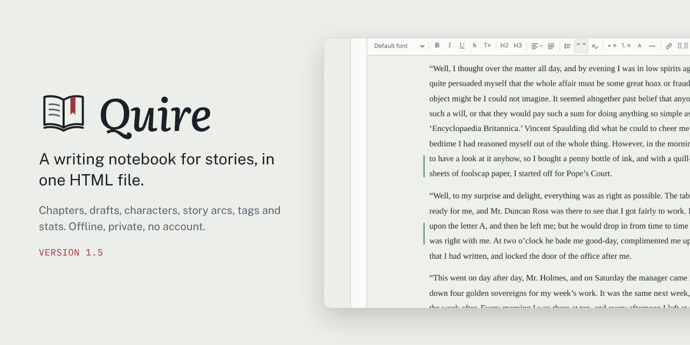
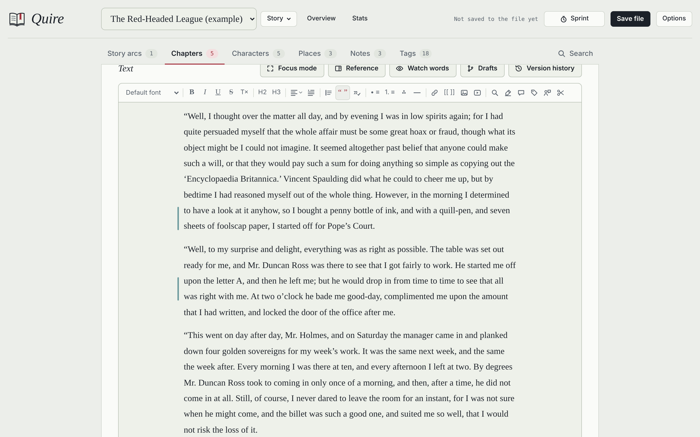
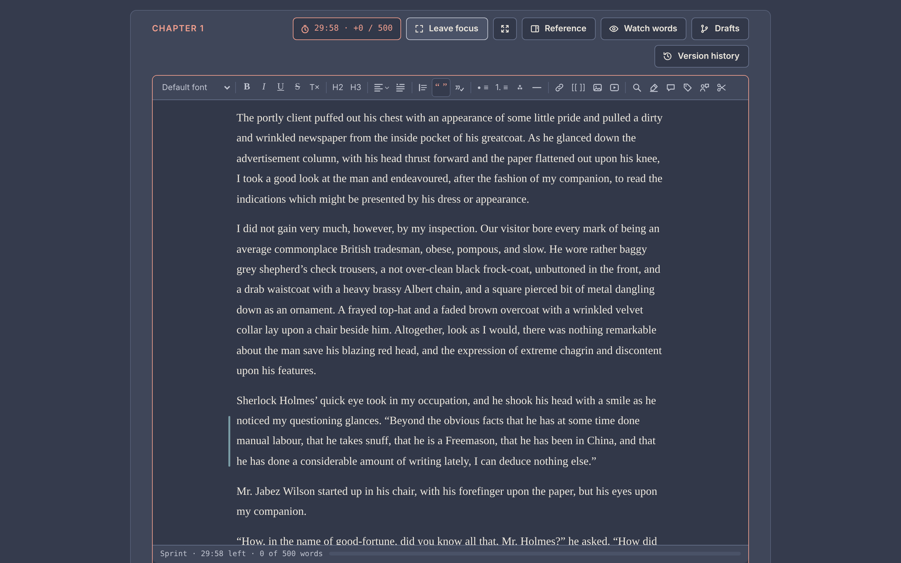
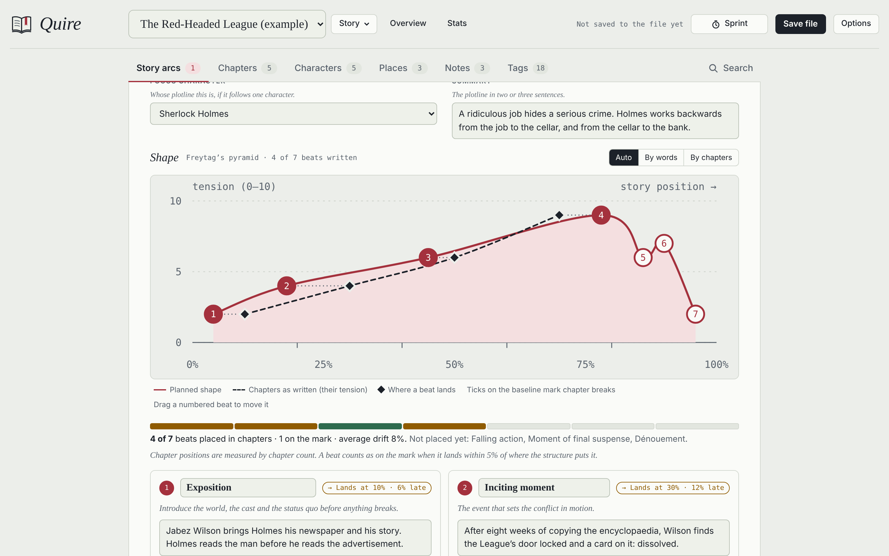
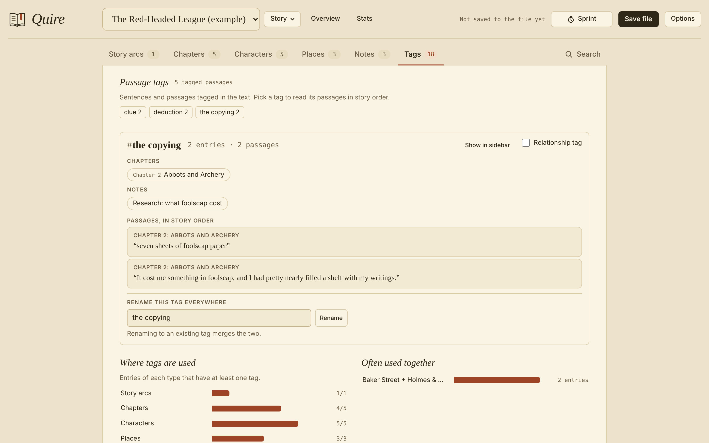
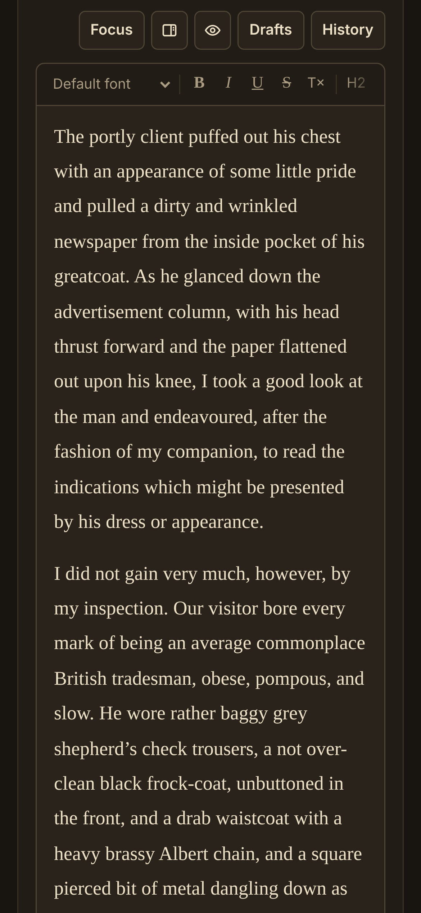

# Quire

**A writing notebook for stories, in one HTML file.** Open it in a browser and start writing. No account, no install, and it works offline.

**[Try it online](https://antariuk.github.io/quire/quire.html)** · **[Download quire.html](https://github.com/antariuk/quire/releases/latest/download/quire.html)** · [Tutorial](docs/TUTORIAL.md) · [What's new](CHANGELOG.md)

## Private by design

Your writing stays in the file and in your browser. Quire sends nothing anywhere, has no tracking or analytics, and only goes online if you switch on Google Fonts. The whole program is plain JavaScript inside the file, with no outside code, so you can read every line of it.

The file also carries a security rule that your browser enforces: `quire.html` may reach only Google Fonts (if you turn them on). Anything else, such as a hidden script trying to send your text somewhere, is blocked. See [What can the file connect to?](#what-can-the-file-connect-to)

If you like, Quire encrypts your backups and the saved file with a password (AES-256), so a lost laptop or a shared cloud folder doesn't give your writing away.

## Getting started

1. **Download** `quire.html` and keep it where you keep your writing.
2. **Open** it in your browser (double-click the file).
3. **Start a story**, or open the example story to see every feature with something in it.
4. **Save file** (Ctrl+S, or ⌘S on a Mac) writes everything into the HTML file itself. That file is your notebook: back it up like any other document.

How saving works, in short:

- **While you write**, Quire keeps your work in this browser's storage, so nothing is lost if the tab closes.
- **Save file** stores everything inside `quire.html`. In Chrome and Edge you choose the file once and later saves overwrite it. In Firefox and Safari each save downloads an updated copy, which lands in your Downloads folder unless you tell the browser otherwise. In Firefox, turn on *Settings → General → Files and Applications → Always ask you where to save files*, then pick your Quire file each time and confirm replacing it. A reminder nudges you when work has gone unsaved for a while.
- **Backups** (Options → Backup) save one story or all of them as a `.json` file, which any copy of Quire can restore.
- **Encryption** (Options → Backup, optional) locks backups and the saved file with a password. A meter rates the password as you choose it. Forget the password and the writing can't be recovered, so keep it safe.
- **The online version** keeps your work in that browser only. To keep your writing safe, download the file and use Save file.

## Features

**Writing**
- A clean editor with headings, quotation blocks, lists, scene breaks, alignment and a choice of fonts
- Book-style paragraph indents, plus smart quotes (English, German or French style), em dashes and ellipses as you type
- Focus mode in two stages: *Focus* hides the navigation; *Intense focus* leaves only the text, its toolbar and the buttons above it. On larger screens, full screen hides the browser's own bars too.
- Picks up where you left off: Quire reopens the chapter you were writing, at the spot where you stopped
- A reference panel keeps a character, place, note or another chapter beside the text while you write, and Go to (Ctrl+K) jumps to any entry, tag or command in a few keystrokes
- Typewriter scrolling, adjustable text size and page width, six themes from light to a warm dark, and your own themes from four colors
- Writing sprints with a timer, a word goal and a chime; a progress bar at the bottom of the screen during sprints, toward a chapter's word target, or toward today's share of a deadline
- Word targets per chapter and for the whole story, a deadline that works out the words a day it takes, a word count for any selection, and find and replace

**Drafts and history**
- Drafts: try out changes in a copy of a chapter, then merge them change by change. A merge can be undone.
- Version history: replay how a chapter was written, compare versions and name the important ones
- Milestones: name the current version of every chapter at once ("Draft 2 finished"), then compare a chapter with it or bring a chapter back
- Undo (Ctrl+Z) for typing and for Quire's own changes: marks, tags, comments, alignment and more

**Planning**
- Sheets for the story, chapters, characters, places and notes, with portraits and place images
- Story arcs on a tension curve, built from classic structures and checked against your chapters
- Links between entries with `[[Title]]`, from a toolbar button or by typing `[[`, with suggestions, "also known as" names, and backlinks shown automatically
- Your own fields on characters, places, notes, chapters and story arcs: one line, longer text, a choice list, a number or a date
- Story time: real dates, plain days or a calendar of your own (months, weekdays, eras, leap years), times for chapters and single scenes, and a story timeline that shows flashbacks
- A title image for each story, which can become the e-book's cover
- Tags on three levels: entries, images (sorted as portrait, landscape or square by themselves) and individual passages. A passage tag lists its passages in story order, so you can follow a subplot or a clue through the book.
- Tag suggestions as you type, including chapters, characters, places and notes, which become links
- Scene labels: whose point of view each scene follows, and when it happens, and how a chapter's words, and the whole story's, divide between viewpoints
- Status colors: every chapter colored by its status, with a strip of the whole manuscript at a glance
- Chapter cards with each chapter's synopsis, viewpoint, places and story arc beats, to drag into a new order
- Select several chapters to change their status, type, tags or time together, move them to the trash, or drag them as a block
- A cast check that lists the characters and places named in a chapter but missing from its lists

**Revising**
- Prose checker: Hemingway-style readability (hard sentences, adverbs, passive voice, wordy phrases), plus word echoes and dialogue
- Watch words: list habits to avoid or facts to keep straight, and a quiet note appears beside the line when you type one
- Comments on any passage
- Stats from basic to in-depth: daily progress, dialogue share, sentence rhythm, word variety, reading level, sentence openers, punctuation, repeated phrases and a narration check
- Voices: compare how your viewpoint characters narrate, with their favorite words and phrases, rhythm, the senses they lean on (with your own sense words), and how a voice changes from chapter to chapter; mark who says each line, quickly, and compare how your characters speak too

**Saving and sharing**
- Export the manuscript as a Word manuscript in standard format for submissions, a regular Word document with real headings, an e-book (EPUB) for e-readers and reading apps, a web page, Markdown or plain text, or print it or save it as PDF
- Import chapters from Word (.docx), keeping italics, scene breaks, images and comments, or from text and Markdown files
- Optional AO3 sharing: copy a chapter for AO3 in one click and open the right page there
- Backups of one story or all of them, optionally encrypted
- Trash: deleted chapters, sheets, notes and whole stories wait there for 30 days, and come back with all their links
- An optional password on the saved file itself

Built-in help, with search, explains every feature, and the [tutorial](docs/TUTORIAL.md) walks through the core features and settings with screenshots.

## Screenshots

| Intense focus, with a sprint running | A story arc on its tension curve |
|---|---|
|  |  |
| **A passage tag, followed through the story** | **On a phone** |
|  |  |

## Browsers

Current Firefox, Chrome, Edge and Safari, on desktop and phone (Firefox 113, Chrome and Edge 111, Safari 16.4 or later). The Prose checker's highlights need Firefox 140 or Safari 17.2 or later; everything else works without them.

Quire needs JavaScript, which browsers allow by default. If you use a blocker such as NoScript, allow it for the file; it runs only on your own device.

## Questions

**Is it really just one file?** Yes. The page, the styles and the program are all inside `quire.html` (about 890 KB empty). Your stories, images and history are stored in the same file when you save.

**Can I use it on more than one computer?** Yes: save, take the file with you, and open it there. Use one copy at a time, so that two copies don't drift apart.

**What about the example story?** It holds two chapters of "The Red-Headed League" by Arthur Conan Doyle (1891), from Project Gutenberg, which are in the public domain. The outlines, sheets, notes and tags around them were written for the example. Delete it from the Story menu whenever you like.

**How was Quire made?** With the help of Claude, Anthropic's AI assistant.

**Why does Quire mention Claude?** Only in that credit, in Help. Quire is also available as a page hosted inside Claude, and that copy has extra code for its storage there. The downloadable `quire.html` doesn't contain any of it: it is built without that code, and nothing in it talks to Claude or Anthropic.

**What can the file connect to?**
- **Google Fonts**, only if you switch them on (Options → Text), to load typefaces.
- **Pages you open yourself**: a link you click, or the AO3 page that AO3 sharing opens in a new tab.
- **Nothing else.** A security rule at the top of the file (a Content-Security-Policy) tells your browser to block every other connection. Web addresses you may spot inside the file, such as `schemas.openxmlformats.org` or `www.idpf.org`, are names the Word and e-book formats require as labels; nothing ever connects to them.

## Feedback

Found a bug or have an idea? [Open an issue](https://github.com/antariuk/quire/issues/new/choose). For bugs, say which browser and system you use and whether you work in the downloaded file or the online version. Please don't paste private writing into issues.

## License

[MIT](LICENSE). The example story's text is in the public domain.
