# Getting around Quire

A short tour of Quire's core features and settings, using the example story that comes with it. It takes about fifteen minutes. Everything here is also explained in Quire's own Help (Options → Help and info), which you can search.

**Contents:** [Start](#1-start) · [The layout](#2-the-layout) · [Chapters](#3-chapters) · [Writing](#4-writing-a-chapter) · [Focus mode](#5-focus-mode) · [Reference panel](#6-the-reference-panel) · [Go to](#7-go-to) · [Characters, places and notes](#8-characters-places-and-notes) · [Story arcs](#9-story-arcs) · [Tags and search](#10-tags-and-search) · [Revising](#11-revising) · [Stats](#12-stats) · [Settings](#13-settings) · [Saving and backups](#14-saving-and-backups) · [Bringing writing in and out](#15-bringing-writing-in-and-out) · [The trash](#16-the-trash) · [On a phone](#17-on-a-phone) · [Help](#18-help)

---

## 1. Start

Open `quire.html` in your browser. The first time, Quire offers two ways in:

- **Start a new story** gives you an empty story to fill.
- **Open an example story** loads two chapters of *The Red-Headed League* by Arthur Conan Doyle, with characters, places, notes, a story arc and tags filled in. It's the quickest way to see every feature with something in it. Delete it from the Story menu once you're done.

## 2. The layout

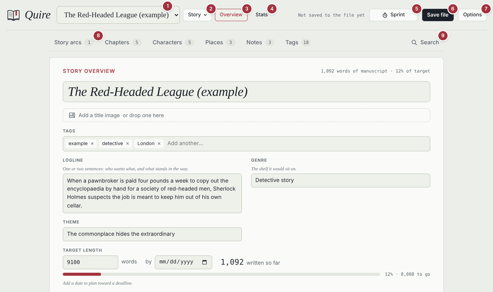

1. **Story picker.** Switch between your stories.
2. **Story menu.** Go to, new story, the example story, duplicate, delete, the trash, find and replace across the story, and importing chapters.
3. **Overview.** The story's own sheet: title, logline, genre, theme, target length and deadline, and a count of everything in it.
4. **Stats.** Word counts, writing pace, chapter lengths, point of view, cast presence, Voices and more.
5. **Sprint.** A writing timer with an optional word goal and a chime at the end.
6. **Save file.** Writes everything into the HTML file itself (Ctrl+S, or ⌘S on a Mac). It turns dark when there's something unsaved.
7. **Options.** Every setting, plus export, backup and Help.
8. **Tabs.** One for each kind of entry: story arcs, chapters, characters, places, notes and tags. The number shows how many there are.
9. **Search.** Searches the whole story. Start with `#` to find a tag, like `#clue`.

Anywhere in Quire, **Ctrl+K** (⌘K on a Mac) opens [Go to](#7-go-to), the quickest way to get anywhere.

**Prefer a sidebar?** Options → Display → Navigation → Sidebar puts the tabs and the list of entries in a column on the left, the way older versions of Quire looked. On a phone, the sidebar becomes its own page.

## 3. Chapters

The Chapters tab shows every chapter as a card: its title, status, word count against its target, the start of its synopsis, and who tells it, where it's set and which story arc beats it carries.

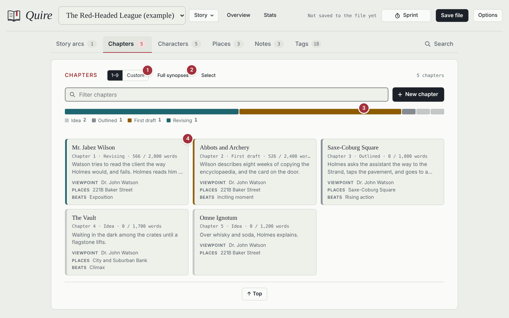

1. **Order.** *1–9* keeps manuscript order. *Custom* lets you drag the ⋮⋮ handles to rearrange chapters, or click a handle and use ↑ ↓. Chapter numbers follow the new order, and Undo appears after each move.
2. **Full synopses** shows each chapter's whole synopsis instead of the first lines.
3. **The status strip** (switched on with Options → Display → Color chapters by status) shows the whole manuscript at a glance, one block per chapter, sized by length and colored from *Idea* to *Done*. Click a block to open that chapter.
4. **A card.** Click it to open the chapter.
5. **Select** lets you change several chapters at once. Tick them (Shift-click ticks everything in between), then set their status or type, add or remove a tag, give them a time, or move them to the trash. With *Custom* order, dragging one ticked chapter moves all of them together. Every change has an Undo.

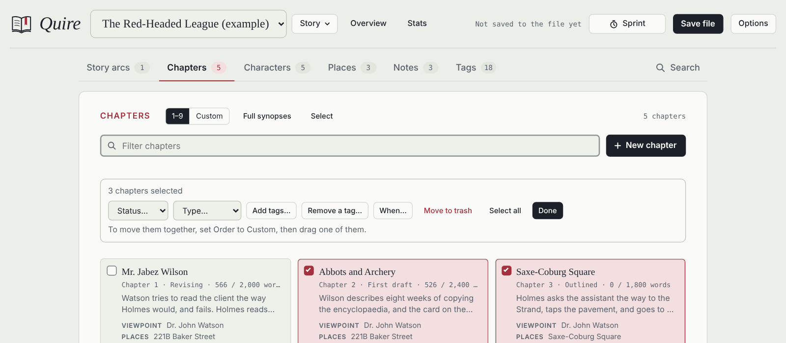

Each chapter has its own sheet above the text: target length, tags, and **Chapter details** with type (chapter, prologue, scene and so on), status, narration, point of view, the characters and places in it, when it happens, a synopsis and the arc beats it carries.

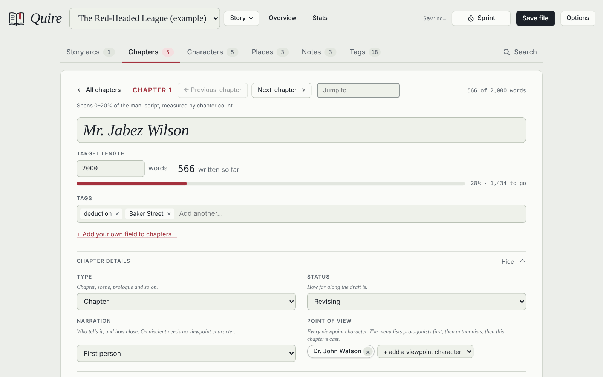

**The cast check** keeps those lists honest. Under *Characters in this chapter* and *Places*, Quire lists the characters and places whose names appear in the chapter's text but who aren't on the lists yet, with how often they're named. In chapter 2 of the example, Duncan Ross and Vincent Spaulding are both named but were never added to the cast:

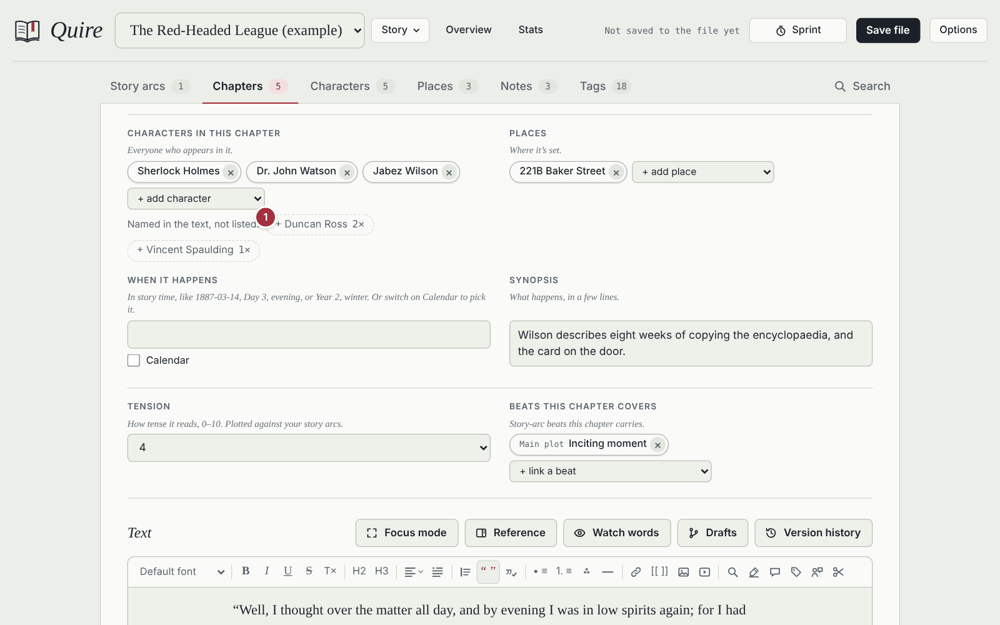

Click one to add it. Quire looks for each name exactly as written, and for the other names listed under *Also known as* on the character or place sheet, so if the text calls Sherlock Holmes "Holmes", add "Holmes" there. Nothing is added unless you click.

**When it happens** takes any wording, like "1887-03-14" or "Day 3, evening". Switch on **Calendar** beside it to pick a date and time from the story's calendar instead, with an optional end for a chapter that spans several days. The calendar is chosen on the story overview under *Story time*: real dates, plain days, or a calendar of your own with its months, weekdays, eras and leap years. There you can also name points in time ("The Long Winter") and set the span the whole story covers. The overview also takes a **title image**, which the e-book can use as its cover.

## 4. Writing a chapter

Scroll down a chapter's sheet to its text.

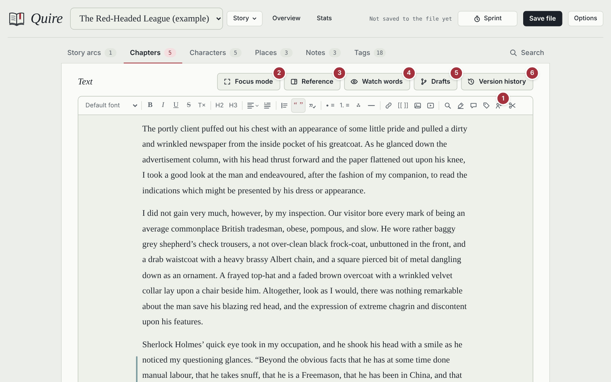

1. **The toolbar.** From left to right: font, bold, italic, underline, strikethrough, clear formatting, heading and subheading, alignment, paragraph indents, quotation block, smart quotes, bulleted and numbered lists, scene break, horizontal line, web link, link to an entry, image, embedded video or music, find and replace, the Prose checker, passage tag, *Who says this*, comment and split chapter. Hover over any button for its name.
2. **Focus mode** hides everything but your writing (see below). The full-screen button next to it hides the browser's own bars too.
3. **Reference** opens the [reference panel](#6-the-reference-panel) beside the text.
4. **Watch words** lists words to notice while you write, including ones for this chapter only (see [Revising](#11-revising)).
5. **Drafts** let you try out changes in a copy of the chapter. The main text stays untouched until you merge, change by change.
6. **Version history** replays how the chapter was written (see [Revising](#11-revising)).

Options → Display → **Buttons above the text…** changes the order of these buttons and which ones show.

A few things happen as you type: `"quotes"` become “quotes” (English, German or French style), `--` becomes —, and `...` becomes …. Ctrl+Z right after undoes just that.

**Undo** (Ctrl+Z, redo with Ctrl+Shift+Z or Ctrl+Y) steps back through your typing and Quire's own changes to the text, such as speaker marks, passage tags, comments and alignment, in the order you made them. On a phone, the message that appears after such a change has an Undo button.

**Links:** select a name and press **[[ ]]** to make it a link, or press it anywhere else for an empty link that suggests entries as you type. Typing `[[` does the same. A link finds an entry by its title or by one of its *Also known as* names, and the entry you link to lists the link back.

**Who says this** marks who speaks each line of dialogue, for Voices in Stats. Click into a line, press the speaker button, and pick a name. The panel stays open: click into the next line, or press **Next unmarked line**, and pick again. With a keyboard, 1–9 pick a speaker and N moves on. Marked lines get a dotted bar in the right margin.

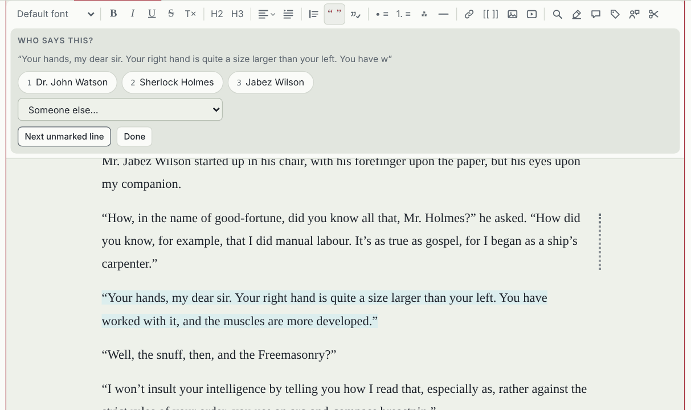

To say whose *scene* it is, don't select text: use the small labels at the start of the chapter and at each scene break, which appear once the chapter has two viewpoint characters. When the chapter has a time, each scene break also gets a clock, so a flashback scene can have its own date.

To bring writing in, paste it (formatting is kept, clutter is dropped), drop an image straight into the text, or use [Import chapters](#15-bringing-writing-in-and-out).

## 5. Focus mode

**Focus mode** hides the title bar, tabs and sheet, and leaves the text. Press Esc or *Leave focus* to bring everything back. With **Intense focus** (Options → Display), only the text, its toolbar and the buttons above it remain. On larger screens, the full-screen button next to it hides the browser's own bars too.

A running sprint stays visible above the text. Here it is in the Twilight theme, with a sprint 2 seconds in and 5 words written:

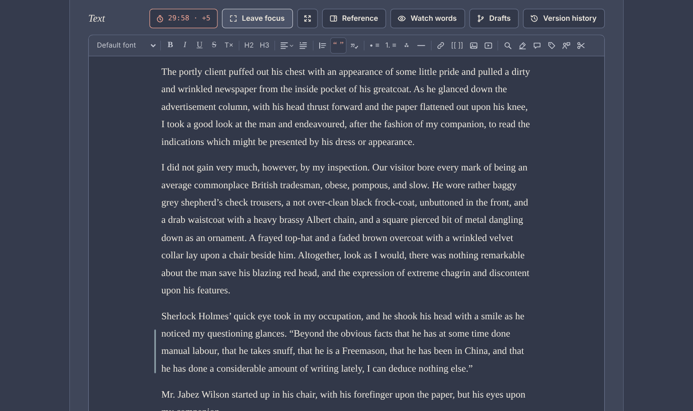

## 6. The reference panel

What color was Holmes's dressing gown? What did your research note say about the price of foolscap? The **Reference** button above a text opens a panel beside it, so you can look things up without leaving the chapter.

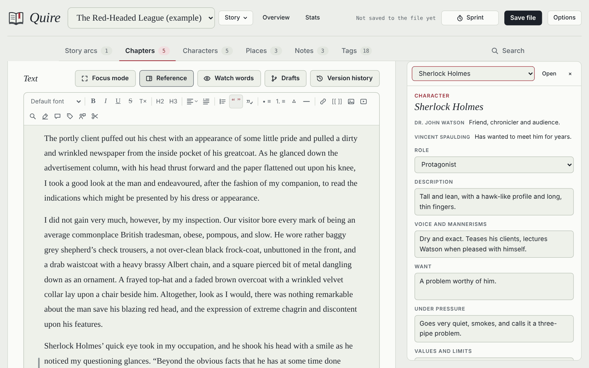

- **Choose what to show** from the list at the top: any character, place, note, story arc or other chapter. In a chapter, its own cast and places are listed first.
- **Short fields can be edited right there**, so a detail you settle while writing goes straight onto the sheet. Longer formatted text, like a note, shows as it is; *Open* takes you to the whole entry to edit it, with its tags.
- **On wide screens** the panel stays beside the text as you move from chapter to chapter, and Quire remembers it after a reload. **On smaller screens** it slides over the text, and closes when you go to another entry.
- × closes it.

## 7. Go to

Press **Ctrl+K** (⌘K on a Mac), or choose Story → Go to…, and type a few letters:

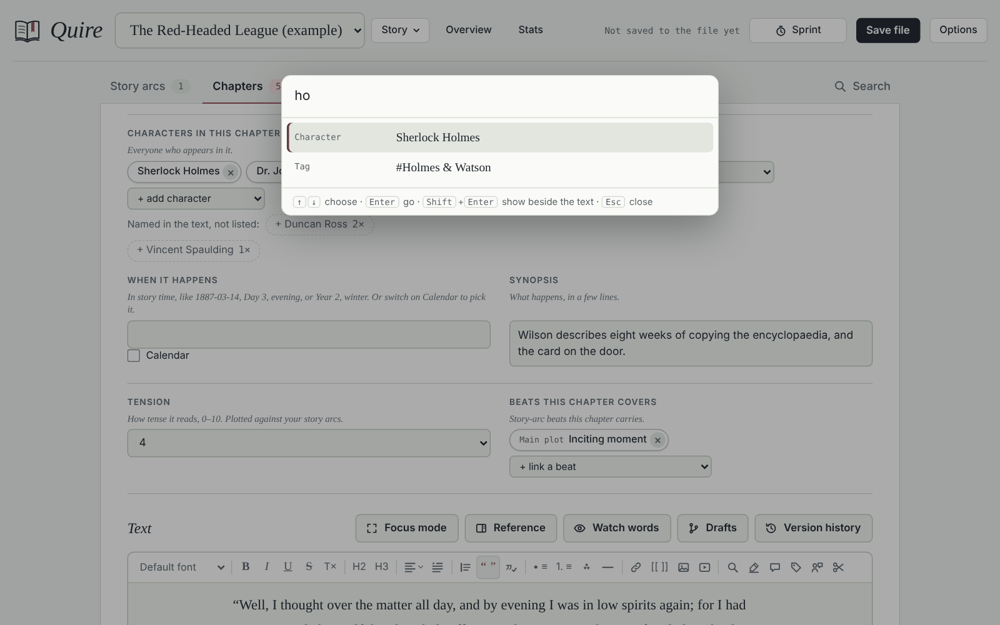

- **Entries:** any chapter, character, place, note or story arc. Characters are also found by the names under *Also known as*.
- **Tags** (`#Holmes & Watson`) and your **other stories**.
- **Commands:** New chapter, Stats, the trash, Find and replace, each export, Save file, a theme, and more.

↑ and ↓ choose, Enter goes there, and **Shift+Enter** puts the chosen entry in the reference panel instead of leaving the chapter. With nothing typed, Go to lists the entries you opened last.

## 8. Characters, places and notes

Characters and places each get a sheet with prompts for what matters about them: role, motivation, psychology, an arc, and relationships to other characters for people; look, sound, smell and significance for places. Both can have a portrait or image. Notes are free-form pages for research, scene ideas, playlists or anything else.

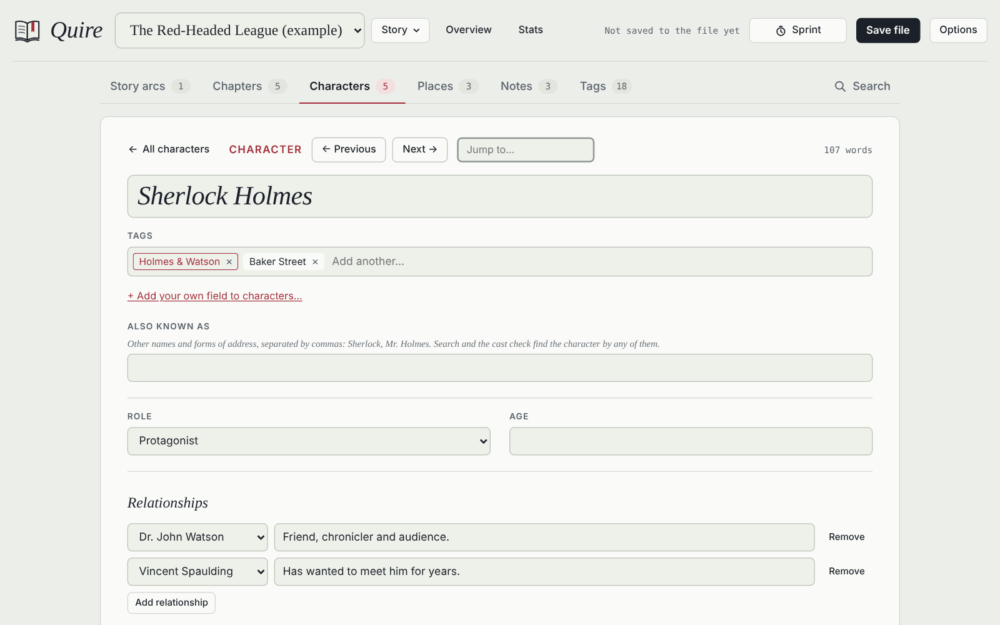

Under **Also known as**, list a character's other names (*Sherlock, Mr. Holmes*), and search and `[[links]]` find them by any of them.

**Your own fields** sit under the tags: press *+ Add your own field* to add fields like Magic, Rank or Born, as one line, longer text, a choice list, a number or a date. They appear on every character (or place, note, chapter or story arc) in the story, or in all your stories if you tick *Every story*.

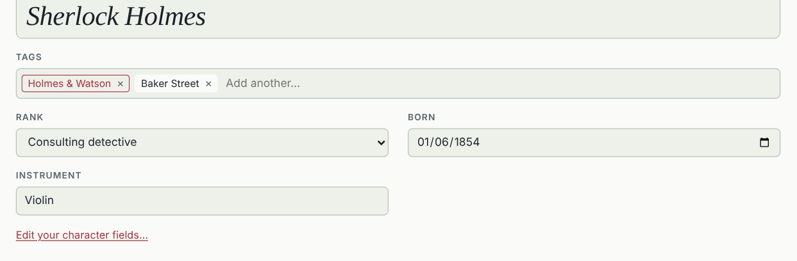 Hints under each field explain what it's for; Options → Display → Field hints makes them smaller or hides them.

## 9. Story arcs

A story arc lays out a plotline on a tension curve. Start from a classic structure (Freytag's pyramid, the three-act structure, Save the Cat, the hero's journey or kishōtenketsu) or a blank arc, then drag the numbered beats along the story and up or down in tension.

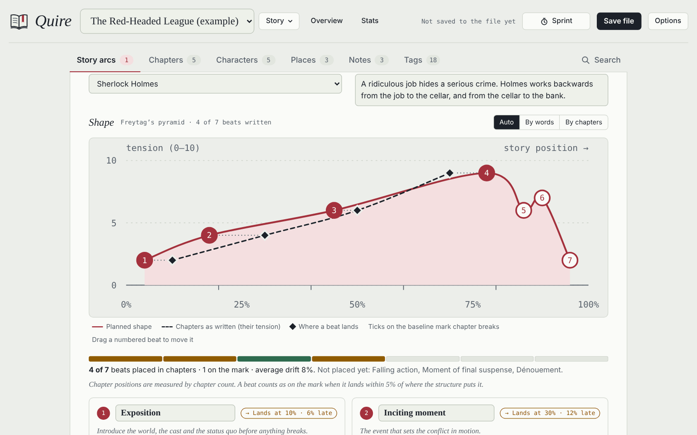

Link each chapter to the beats it carries, from the chapter's details. The dashed line then shows your chapters as written, and each beat says whether it lands where the structure puts it, early or late.

## 10. Tags and search

Tags work on three levels:

- **Entries:** add tags to any sheet. As you type, Quire suggests existing tags, and chapters, characters, places and notes, which become links.
- **Images:** click an image to tag it. Quire adds its shape (portrait, landscape or square) by itself.
- **Passages:** select a sentence or a passage and press the tag button in the toolbar. A bar in the margin marks it. A passage tag lists its passages in story order, so you can follow a subplot or a clue through the book.

A tag joining two names with `/` or `&`, like *Holmes & Watson*, is a relationship tag and shows in red italics.

The Tags tab shows all of them, how often they're used and what they're used on. Select a tag to see everything that carries it.

## 11. Revising

**The Prose checker** (the pencil button in the toolbar) marks hard and very hard sentences, adverbs, passive voice and wordy phrases, after Hemingway's readability rules, plus word echoes and dialogue. Click a highlight to see why it's marked, or a category to show or hide it. Options → Text → Prose checker chooses between the full checker and Hemingway's rules only.

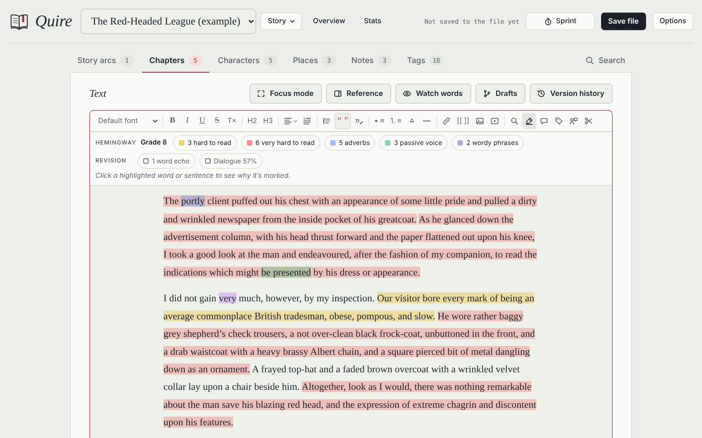

**Watch words** are words and phrases you want to notice: a habit to break, or a fact to keep straight. When you type one, a small note appears beside the line and fades away without interrupting you. The *Watch words* button above a text edits the list for every story, for this story, or for this chapter only, for something that matters just there for a while, like a name a character shouldn't know yet. Options → Text switches watch words on or off.

**Comments:** select some text and press the speech-bubble button. Comments are listed under the text and left out of every export.

**Version history** keeps a snapshot whenever you pause writing in a chapter and when you leave it. Replay how the chapter grew, compare any version with the one before, name important ones ("Sent to beta readers"), and restore or copy an old version.

**Milestones** (Story ▾ → Milestones) name the current version of every chapter at once, like "Draft 2 finished". Later, compare any chapter with a milestone, or bring one chapter back to it; the text it has today stays in its history.

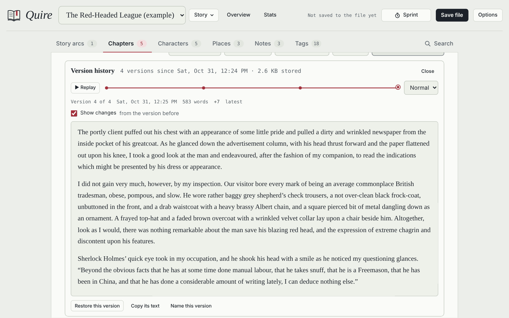

## 12. Stats

Stats covers the whole story: manuscript length against your target, writing pace and streak, chapter lengths, draft status, point of view, cast presence, settings, story arc coverage and a story timeline. The switch at the bottom changes the level of detail, from *Basic* to *In depth*, which adds sentence rhythm, openers, punctuation, repeated phrases and a narration check.

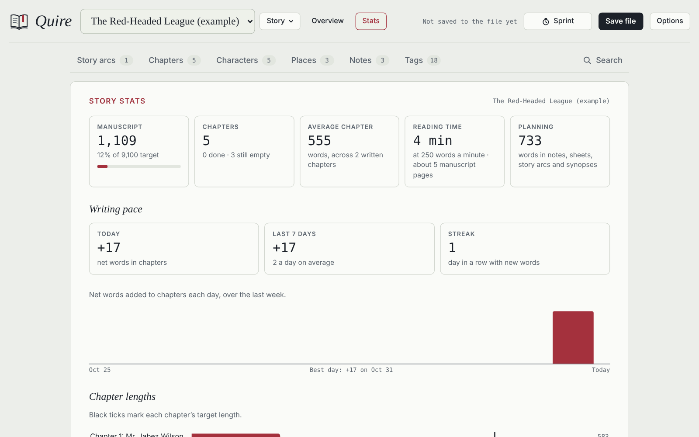

The **Story timeline** puts your chapters in story order. Scenes with their own time appear indented under their date, and flashbacks are marked, so a flashback inside a chapter shows where it belongs without changing the chapter's word counts.

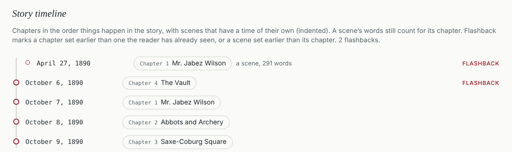

**Voices** compares how your viewpoint characters narrate: their sentence length, favorite words and phrases, the senses they lean on, and whether a voice drifts from chapter to chapter. Senses are counted per 1,000 words; open *Words counted* to see which words counted, and *Your sense words…* to add your own, like a smell that runs through your story. Mark who says a line of dialogue with the *Who says this* button, and Voices compares how your characters speak too. Only lines you mark count; Quire never guesses a speaker.

## 13. Settings

Everything is in **Options**. This is the whole menu, laid out in three columns:

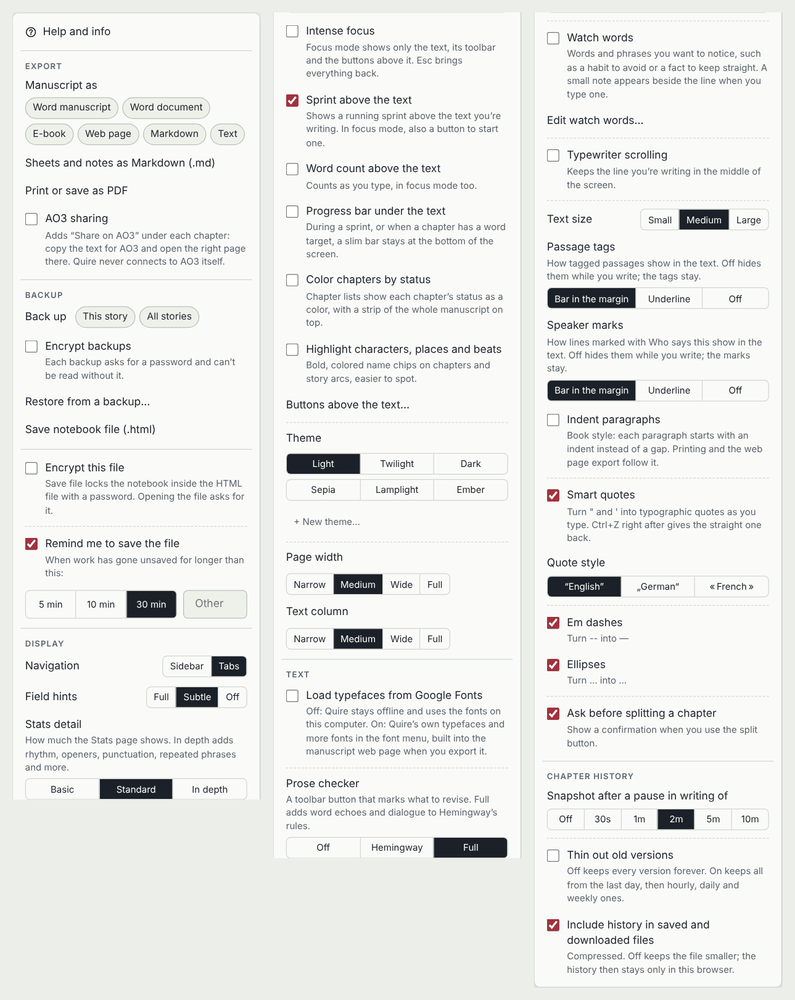

- **Export:** the manuscript as a Word manuscript (standard manuscript format, for submissions), a Word document, an e-book, a web page, Markdown or text; sheets and notes as Markdown; print or PDF; AO3 sharing.
- **Backup:** back up this story or all of them, encrypt backups, restore, save the notebook file, encrypt the file and the save reminder.
- **Display:** sidebar or tabs, field hints, stats detail, intense focus, the sprint and word count above the text, the progress bar, status colors, highlighted name and beat chips, the buttons above the text, theme, page width and text column width.
- **Text:** Google Fonts, the Prose checker, watch words, typewriter scrolling, text size, how passage tags show, paragraph indents, smart quotes and their style, dashes, ellipses and the question before splitting a chapter.
- **Chapter history:** how soon after a pause a snapshot is taken, thinning out old versions, and whether history goes into the saved file.

**Themes:** pick one of six (Light, Twilight, Dark, Sepia, Lamplight, Ember), or **+ New theme…** to make your own from four colors. Quire works out the other shades, previews the theme as you go and checks the text stays readable.

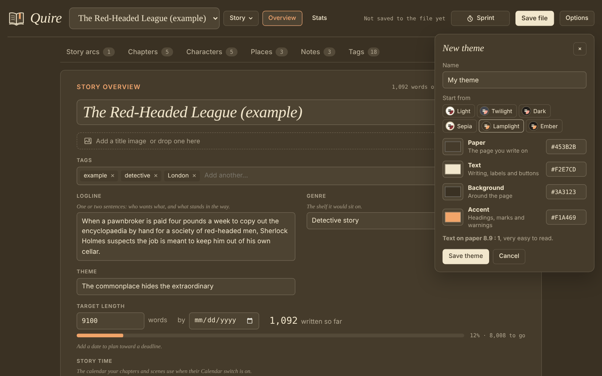

## 14. Saving and backups

- **While you write,** Quire keeps your work in the browser's storage, so a closed tab loses nothing.
- **Save file** (Ctrl+S) writes everything into `quire.html` itself. **The file is your real copy:** keep it with your writing and back it up like any document. In Chrome and Edge you choose the file once and later saves overwrite it. Firefox and Safari download an updated copy each time, by default into your Downloads folder. To save over your Quire file in Firefox, open *Settings → General → Files and Applications* and turn on **Always ask you where to save files**. Each Save file then asks where to put it: choose your Quire file and confirm that you want to replace it. Firefox remembers the folder. A reminder nudges you if work has gone unsaved for a while.
- **Backups** (Options → Backup) save one story or all of them as a `.json` file, which any copy of Quire can restore.
- **Encryption** (Options → Backup, optional) locks backups and the saved file with a password. If you forget it, nobody can recover the writing, so keep it safe.

## 15. Bringing writing in and out

**Import chapters** (Story → Import chapters) reads Word documents (.docx), text and Markdown files, or pasted text. Quire shows the chapters it found before adding anything. A new chapter starts at each heading, or at lines like "Chapter 3" or "Prologue". From Word, italics, bold, scene breaks, lists, links and images come along, comments become Quire comments, tracked changes are taken as accepted, and footnotes go at the end of their chapter. You can also just drop a file onto Quire.

**E-book** (Options → Export → E-book) makes an EPUB for Apple Books, Kobo, Google Play Books, and Kindle through Send to Kindle, with a table of contents, a title page and a simple cover.

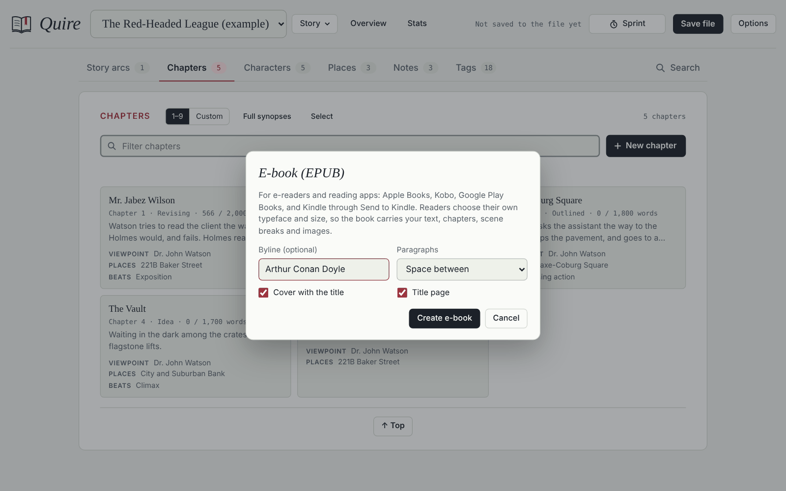

## 16. The trash

Deleting a chapter, sheet, note, story arc or whole story moves it to the trash (Story → Trash) for 30 days, and Undo appears right after deleting. Restoring brings it back as it was, with its places in viewpoints, cast lists, arcs and speaker marks. *Delete for good* or *Empty the trash* removes things for good straight away.

## 17. On a phone

Quire works on phones too. The title bar stacks up, the tabs scroll sideways, and the toolbar stays at the top while you write.

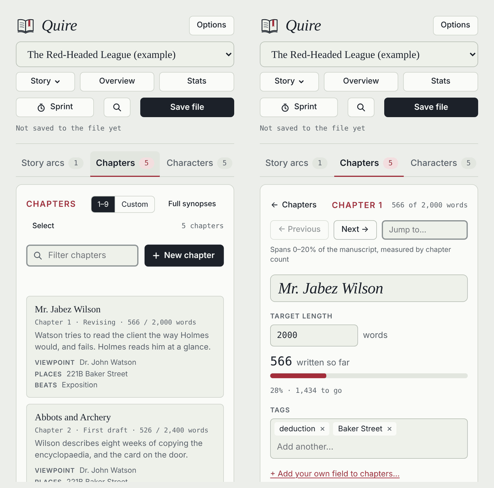

To use the same notebook on your phone, copy `quire.html` there (with a cloud folder, say) and open it in the phone's browser. Use one copy at a time, so two copies don't drift apart.

## 18. Help

Options → **Help and info** explains every feature, with topics to jump to and a search: press `/`, type, and Enter steps through the matches.

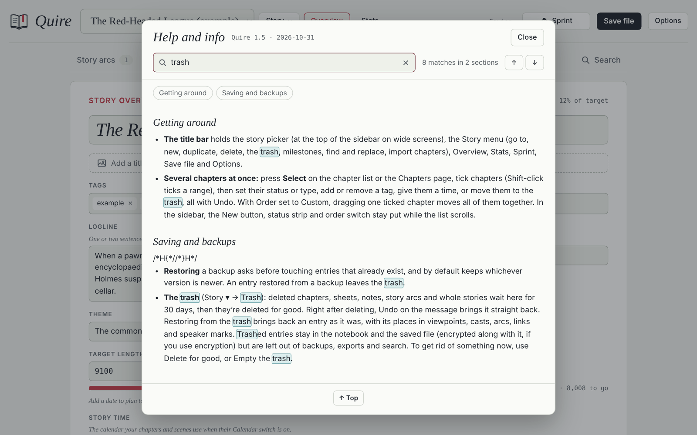

Found a bug or have an idea? [Open an issue](https://github.com/antariuk/quire/issues/new/choose).
